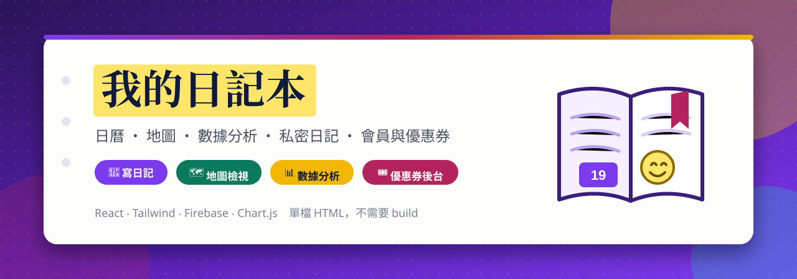
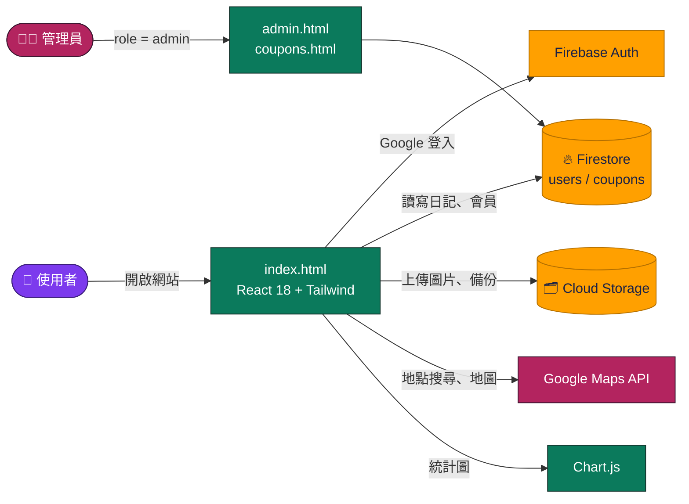

<a id="top"></a>

<div align="center">



<br>

[](https://github.com/Jiachang1112/journal)
[](https://github.com/Jiachang1112)

[](https://developer.mozilla.org/docs/Web/HTML)
[](https://react.dev/)
[](https://babeljs.io/docs/babel-standalone)
[](https://tailwindcss.com/)
[](https://www.chartjs.org/)
[](https://firebase.google.com/)
[](https://firebase.google.com/docs/firestore)
[](https://firebase.google.com/docs/auth)
[](https://firebase.google.com/docs/storage)
[](https://developers.google.com/maps)
[](https://formspree.io/)
[](#-快速開始)

**雲端日記本 ‧ 日曆／地圖／數據分析 ‧ 私密日記 ‧ 會員與優惠券 ‧ 管理後台**

<br>

[](#-快速開始)
[](#-特色)
[](#-設定你自己的服務)
[](#-設定-google-maps)
[](#-會員與優惠券)
[](#-注意事項)
[](#-常見問題)

</div>

---

## ✨ 特色

<table>
<tr>
<td width="33%" valign="top">

### 📔 寫日記
標題、內容、日期、地點、心情、天氣、標籤，還能上傳圖片。可以只看「最愛」，也能一鍵跳到今天。

</td>
<td width="33%" valign="top">

### 🗓️ 日曆・🗺️ 地圖・📊 分析
用日曆看哪天寫過、在地圖上看去過哪裡，用圖表看心情變化。

</td>
<td width="33%" valign="top">

### 🔒 私密日記
可以設定私密日記密碼，密碼會先用 SHA-256 雜湊後才存進資料庫。

</td>
</tr>
<tr>
<td valign="top">

### ⏰ 提醒
設定寫日記的提醒時間，到時會發出瀏覽器桌面通知（需要保持網頁開著）。

</td>
<td valign="top">

### 💾 匯出與備份
日記可以匯入、匯出 JSON，也能備份到 Cloud Storage，需要時再從 Storage 還原。

</td>
<td valign="top">

### 🎨 自訂主題色
用色票選自己喜歡的主題色，設定會記在瀏覽器裡。

</td>
</tr>
<tr>
<td valign="top">

### 💎 會員等級
Free／Pro／VIP 三種等級，月費 NT$ 150、年費 NT$ 1,500，可套用優惠券折抵。**付款目前是示範流程**，見下方說明。

</td>
<td valign="top">

### 🎟️ 優惠券後台
管理員可以建立優惠券（折抵金額、延長月數、使用上限、到期時間），並查看兌換紀錄。

</td>
<td valign="top">

### 🛡️ 管理後台
管理員可以查看使用者清單與日記列表，並進行管理。

</td>
</tr>
</table>

### 🔗 頁面一覽

| 頁面 | 檔案 | 內容 |
| --- | --- | --- |
| 📔 日記本 | `index.html` | 主程式，所有日記功能都在這一頁 |
| 🛡️ 管理後台 | `admin.html` | 使用者清單與日記列表（僅管理員） |
| 🎟️ 優惠券管理 | `coupons.html` | 建立優惠券與兌換紀錄（僅管理員） |
| 🔧 Firebase 檢查工具 | `firebase-check.html` | 檢查你的 Firebase 設定是否正確 |

---

## 🧩 運作方式



- 網站是**純靜態檔案**，React、Tailwind、Firebase 都從 CDN 載入，**不需要 `npm install` 也不需要 build**。
- React 程式用 Babel Standalone 在瀏覽器裡轉譯，開發方便，但第一次載入會比打包後的版本慢一點。
- 資料放在 Firestore：`users/{uid}` 存個人設定、會員等級與私密密碼雜湊，日記在它底下的 `diaries`；`coupons` 與 `coupon_redemptions` 存優惠券。
- 管理員的判斷是看使用者文件裡的 `role` 是不是 `admin`。

### 📁 檔案說明

```text
journal/
├── index.html            日記本主程式（React，單檔）
├── admin.html            管理後台
├── coupons.html          優惠券管理
├── firebase-check.html   Firebase 檢查工具
└── assets/
    ├── img/
    │   ├── journal-favicon.png   網站圖示
    │   └── settings-icon.png     設定圖示
    └── readme/                   本 README 用的橫幅
```

---

## ⚡ 快速開始

**1. 下載專案**

```bash
git clone https://github.com/Jiachang1112/journal.git
cd journal
```

**2. 啟動本機伺服器**（任何靜態伺服器都可以）

```bash
python3 -m http.server 8000
# 或：npx serve .
```

**3. 打開瀏覽器**

| 想看什麼 | 網址 |
| --- | --- |
| 📔 日記本 | http://localhost:8000/ |
| 🛡️ 管理後台 | http://localhost:8000/admin.html |
| 🎟️ 優惠券管理 | http://localhost:8000/coupons.html |
| 🔧 Firebase 檢查工具 | http://localhost:8000/firebase-check.html |

登入、儲存日記需要連到 Firebase，請繼續看下一節。

---

## 🔥 設定你自己的服務

專案預設連到作者自己的 Firebase。如果你是 fork 或複製來用，**請換成你自己的專案**。

<details open>
<summary><b>① 建立 Firebase 專案</b></summary>

1. 打開 [Firebase 主控台](https://console.firebase.google.com/)，新增專案。
2. 開啟 **Authentication**，登入方式啟用 **Google**。
3. 開啟 **Firestore Database** 與 **Storage**。
4. Authentication → Settings → **已授權網域**，加入你的網域（`localhost` 預設已經有）。

</details>

<details open>
<summary><b>② 換掉 firebaseConfig</b></summary>

專案設定 → 新增網頁應用程式，複製 `firebaseConfig`，把下面這幾個檔案裡的 `firebaseConfig` 都換成你的：

`index.html`、`admin.html`、`coupons.html`、`firebase-check.html`

> 💡 網頁用的 `apiKey` 不是機密，真正保護資料的是 Firestore 與 Storage 的安全規則。

</details>

<details open>
<summary><b>③ 設定安全規則</b></summary>

到 Firestore 與 Storage 的「規則」頁，至少要做到：

- 使用者只能讀寫自己的 `users/{uid}` 與底下的日記。
- `users/{uid}` 裡的 **`role`** 與 **`membership`** 欄位，**不能讓使用者自己改**，只有管理員（或伺服器端）可以。
- `coupons`、`coupon_redemptions` 只有管理員能寫入。
- Storage 只允許使用者存取自己 `{uid}/` 底下的檔案。

</details>

<details open>
<summary><b>④ 指定第一位管理員</b></summary>

先用 Google 登入一次，讓系統建立你的使用者文件，再到 Firebase 主控台的 Firestore，把 `users/{你的 uid}` 文件裡的 `role` 欄位設成 `admin`。之後就能進 `admin.html` 與 `coupons.html`。

</details>

<details open>
<summary><b>⑤ 用檢查工具確認設定</b></summary>

打開 `firebase-check.html`，它會檢查你的 Firebase 專案設定、登入方式與 Firestore 連線，哪一步有問題會直接列出來。

</details>

---

## 🗺️ 設定 Google Maps

地點搜尋（「地點 (全球搜尋)」）與地圖檢視使用 Google Maps JavaScript API。`index.html` 裡載入地圖的網址目前是範例值：

```html
<script src="https://maps.googleapis.com/maps/api/js?key=YOUR_GOOGLE_MAPS_API_KEY&libraries=places">
```

1. 到 [Google Cloud Console](https://console.cloud.google.com/google/maps-apis) 啟用 **Maps JavaScript API** 與 **Places API**，建立 API 金鑰。
2. 把 `YOUR_GOOGLE_MAPS_API_KEY` 換成你的金鑰。
3. 在金鑰設定裡**限制網站來源**（HTTP referrer），避免被別人盜用。

沒換成真的金鑰之前，地點搜尋與地圖檢視無法使用，其他功能不受影響。

---

## 💎 會員與優惠券

| 項目 | 說明 |
| --- | --- |
| 等級 | `free`、`pro`、`vip` |
| 方案 | 月費 NT$ 150、年費 NT$ 1,500 |
| 優惠券 | 可設定折抵金額、延長月數、適用方案、使用上限、到期時間 |
| 兌換紀錄 | 使用者兌換後寫入 `coupon_redemptions`，管理員可在 `coupons.html` 查看 |

> ⚠️ **目前沒有接金流。** 按下「立即升級」只會把會員等級與到期日直接寫進 Firestore，不會扣款。要正式收費，請改接綠界、藍新、Stripe 等金流，並由伺服器端驗證付款後才更新會員狀態。

---

## ⚠️ 注意事項

- **付款是示範**：見上方說明。在接上金流與伺服器端驗證前，請不要把會員功能當成正式收費使用。
- **權限靠 Firestore 規則**：前端的管理員判斷只能控制畫面。如果規則沒有擋住 `role` 與 `membership` 欄位，使用者可能自己改成管理員或會員。
- **私密日記只是第二道鎖**：密碼雜湊存在 Firestore，用來在網頁上鎖住日記畫面，並不是端對端加密，日記內容本身仍以一般方式存放。
- **Google Maps 金鑰**：請務必限制來源網站，並設定使用額度。

---

## ❓ 常見問題

<details>
<summary><b>開啟後畫面空白</b></summary>

1. 確認是用 `http://localhost:8000/` 開的。
2. 按 F12 打開開發者工具，看 Console 有沒有錯誤。
3. 專案要從 CDN 載入 React、Tailwind、Firebase，請確認網路正常，也沒有被瀏覽器擴充功能擋掉。

</details>

<details>
<summary><b>Google 登入失敗，或說網域未授權</b></summary>

Firebase → Authentication → Settings → 已授權網域，加入你的網域。也請確認 Google 登入方式已啟用。

</details>

<details>
<summary><b>儲存日記時說沒有權限</b></summary>

多半是 Firestore 規則還沒設定好，或登入的帳號和規則不符。到 Firebase 主控台看「規則」頁，也可以用 `firebase-check.html` 檢查。

</details>

<details>
<summary><b>地點搜尋或地圖沒有出現</b></summary>

`index.html` 裡的 Google Maps 金鑰還是範例值，請換成你自己的金鑰，並確認已啟用 Maps JavaScript API 與 Places API。

</details>

<details>
<summary><b>進不了管理後台，說需要管理員權限</b></summary>

要在 Firestore 的 `users/{你的 uid}` 文件裡，把 `role` 欄位設成 `admin`，重新整理後再進入。

</details>

<details>
<summary><b>提醒沒有跳出通知</b></summary>

提醒用的是瀏覽器的桌面通知，需要允許通知權限，並且保持日記本網頁開著。

</details>

---

<div align="center">

[GitHub @Jiachang1112](https://github.com/Jiachang1112)　‧　[journal](https://github.com/Jiachang1112/journal)

[](#top)

</div>
